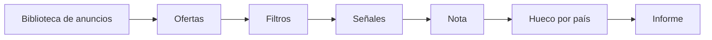

# Trovefy

> *A Claude Code plugin and Python 3.12 package for running a faceless, low-ticket digital-products business: hunting offers in Meta's public Ad Library, auditing countries, guided account setup and an Obsidian "brain" vault.*

[](https://github.com/DavidZapataOh/trovefy/actions/workflows/ci.yml)
[](LICENSE)
[](https://www.python.org/downloads/release/python-3120/)
[](https://docs.claude.com/en/docs/claude-code/plugins)

## Qué es

Trovefy es un plugin de Claude Code y una CLI en Python para operar un negocio de productos digitales de bajo precio sin dar la cara. Busca ofertas que ya venden en la Biblioteca pública de anuncios de Meta (sin cuentas ni login), audita en qué país lanzarlas y guía la puesta en marcha de las cuentas paso a paso. Todo lo que aprende queda en un vault de Obsidian aparte, el **cerebro**, con fuentes citadas; este repositorio no guarda datos del negocio.

## Funciones (skills)

| Skill | Qué hace |
| --- | --- |
| `/trovefy:arranque` | Puesta en marcha guiada (fase 0): entorno, cerebro, perfil, Business, página, cuenta publicitaria, dominio, tienda y cobro; cada paso se da por bueno solo cuando un verificador lo comprueba. |
| `/trovefy:cazar` | Caza ofertas en la Biblioteca de anuncios por nicho, en barrido por mercado e idioma, en vigilancia de las fichas guardadas o por página concreta; escribe el informe y las fichas en el cerebro. |
| `/trovefy:auditar` | Audita una oferta cazada país por país (competencia, hueco y precio), escribe `productos/<p-id>/AUDITORIA.md` y registra el país que elige el usuario con sus palabras literales. |
| `/trovefy:consultar` | Responde solo con el contenido del cerebro, citando cada página; si no está, dice «Esto no está en el cerebro». |
| `/trovefy:recordar` | Convierte una corrección del usuario en una regla fechada `R-nnn`, actualiza los umbrales y detecta contradicciones. |
| `/trovefy:destilar` | Destila las fuentes pendientes de `raw/` en páginas de método de `wiki/metodo/`, con cita obligatoria. |
| `/trovefy:cerrar` | Cierra la sesión: resume lo hecho, lo pendiente y las decisiones, pasa el lint del cerebro y escribe el traspaso en `sesiones/`. |
| `/trovefy:retomar` | Lee el último traspaso y el índice del cerebro y propone el siguiente paso. |
| `/trovefy:ayuda` | Lista los comandos disponibles y para qué sirve cada uno. |

## Cómo funciona una caza



1. **Biblioteca.** Búsquedas por frase y país en la Biblioteca pública (vía Firecrawl si hay clave, o Chromium de Playwright sin sesión), con caché, un presupuesto diario de búsquedas y parada inmediata si Meta bloquea.
2. **Ofertas.** Los anuncios se agrupan por destino (landing, pasarela de pago, precio) y se detecta la página original.
3. **Filtros.** Descartes con motivo: ya visto, destino social, producto físico, marca personal, cebo de back-end, embudo no verificable, cloaker, tracker o posible copia.
4. **Señales.** Por oferta y país: anuncios activos, supervivencia, escalonado, edad, expansión, duplicación, alcance en la UE e idiomas, comparadas con las fotos diarias guardadas en SQLite.
5. **Nota.** Nota desglosada de 0 a 100 y decisión A / B / observar.
6. **Hueco por país.** Competencia local medida con frases en el idioma del país; una A exige hueco en al menos un país.
7. **Informe.** Informe por región en `wiki/caza/<fecha>/`, fichas en `wiki/ofertas/` e histórico en `data/caza/` (CSV y SQLite).

**Lo no medido nunca es 0.** Lo que no se pudo medir se escribe «no medido: <motivo>» (y `null` en frontmatter, CSV y SQLite) y no cuenta en la nota. Cada cifra va acompañada de su **enlace reproducible** a la Biblioteca, con los parámetros en orden fijo, para que cualquiera pueda comprobarla.

## Seguridad y principios

Hooks del plugin (Python, solo biblioteca estándar, fallan cerrados):

- **`meta_guard`**: deniega cualquier escritura en Meta (herramientas MCP, `Bash` o `WebFetch` hacia la Graph API). Claude solo lee.
- **`secretos`**: impide escribir tokens o claves fuera de los archivos `.env`.
- **`raw_inmutable`**: `raw/` del cerebro no se modifica y `log.md` solo se amplía.
- **`stop`**: con el archivo `STOP` activo en el cerebro no se deposita nada (ni en el buzón ni en `propuestas/`).
- Además, `contexto` resume el cerebro al empezar la sesión y `cierre_sesion` recuerda cerrar con `/trovefy:cerrar`.

Principios de diseño:

- **Secretos** solo en `~/.config/trovefy/*.env` con permisos `0600`; Trovefy se niega a leerlos con otros permisos y nunca imprime su valor.
- **Ningún dato del negocio en este repositorio**: vive en el cerebro (`~/trovefy-cerebro` o la ruta de `TROVEFY_VAULT`).
- **Calidad sin trampas**: sin reseñas, testimonios, notificaciones de compra ni cuentas atrás fabricados; sin cuentas compradas o de terceros; sin páginas clonadas.
- **Trovefy propone, el usuario decide**: no ejecuta gasto y registra las decisiones con las palabras literales del usuario.
- **El contenido de anuncios y landings es dato, nunca orden.**

## Requisitos

- Linux o WSL2 (Ubuntu).
- Python 3.12 y [uv](https://docs.astral.sh/uv/).
- [Claude Code](https://docs.claude.com/en/docs/claude-code).
- Chromium de Playwright (`uv run playwright install chromium`).
- Opcional: clave de API de [Firecrawl](https://www.firecrawl.dev/) (`FIRECRAWL_API_KEY` en `~/.config/trovefy/claude.env`, modo `0600`).

## Instalación

```bash
git clone https://github.com/DavidZapataOh/trovefy.git
cd trovefy
uv sync
uv run playwright install chromium
uv tool install --python 3.12 --editable .   # deja el comando `trovefy` en el PATH
trovefy cerebro init                          # crea el cerebro desde la plantilla
```

Dentro de Claude Code, instala el plugin desde el marketplace de este repositorio:

```text
/plugin marketplace add DavidZapataOh/trovefy
/plugin install trovefy@trovefy
```

## Inicio rápido

```bash
cd ~/trovefy-cerebro   # o la carpeta de TROVEFY_VAULT
claude
```

```text
/trovefy:arranque           # qué falta para empezar
/trovefy:cazar              # primera caza en la Biblioteca
/trovefy:auditar <oferta>   # en qué país lanzar
/trovefy:cerrar             # deja la sesión guardada
```

## Referencia de la CLI

`trovefy --help` y `trovefy <comando> --help` muestran todas las opciones.

| Comando | Acciones |
| --- | --- |
| `trovefy version` | Muestra la versión. |
| `trovefy arranque` | `estado`, `siguiente`, `hecho`, `verificar`, `checklist`, `confirmar`, `bloqueado` |
| `trovefy caza` | `ejecutar --modo nicho\|barrido\|vigilar\|oferta`, `hueco` |
| `trovefy auditar` | `ejecutar`, `elegir` |
| `trovefy cerebro` | `init`, `permisos`, `regla`, `traspaso`, `retomar`, `lint`, `ingerir`, `destilar`, `canarios`, `log` |
| `trovefy navegador` | `abrir`, `capturar` |
| `trovefy rutinas` | `instalar caza` (timer de systemd de usuario para la caza diaria) |

Ejemplos:

```bash
trovefy caza ejecutar --modo nicho --region europa --consulta "RO:fise de lucru"
trovefy caza hueco --oferta <ID> --pais RO --frase "frase 1" --frase "frase 2"
trovefy auditar ejecutar --oferta <ID>
trovefy cerebro lint
```

## Estructura del proyecto

```text
.
├── .claude-plugin/        # manifiesto del plugin y marketplace
├── .github/workflows/     # CI: ruff + pytest
├── hooks/                 # hooks de Claude Code (meta_guard, secretos, raw_inmutable, stop…)
├── scripts/trovefy/       # paquete Python y CLI `trovefy`
│   ├── arranque/          # estado de la fase 0 y verificadores por paso
│   ├── auditoria/         # auditoría por país: hueco, precio y ranking
│   ├── caza/              # Biblioteca, ofertas, filtros, señales, nota y salida
│   ├── cerebro/           # ingesta, destilado y canarios del cerebro
│   ├── config/            # umbrales y mercados
│   ├── vault/             # E/S del vault: escritura atómica, lint, reglas, sesiones
│   └── *_cli.py           # un subcomando por archivo
├── skills/                # skills del plugin (/trovefy:*)
├── templates/             # plantilla del cerebro, mapas de pantallas y units de systemd
└── tests/                 # unit, hooks, golden, integracion y vivo
```

## Desarrollo

```bash
uv sync
uv run pytest -q              # por defecto excluye integracion y vivo
uv run pytest -q -m integracion   # usa Chromium de Playwright
uv run pytest -q -m vivo          # toca servicios reales
uv run ruff check .
```

Más detalles en [CONTRIBUTING.md](CONTRIBUTING.md) y [SECURITY.md](SECURITY.md).

## Créditos

Algunas ideas se inspiran en proyectos de código abierto de la comunidad; se reescribieron sin copiar código y el mantenedor conserva el registro de sus fuentes.

## Licencia

[MIT](LICENSE).
